# Shop Selina — Modern E-Commerce Web Application

> A fully responsive, feature-rich e-commerce web application featuring a customer storefront, persistent shopping cart, secure authentication, and an administrative dashboard. Built as an individual capstone project for the BE-XPERT Frontend Development course.

---

## 🚀 Live Demo & Repository
* **GitHub Repository:** [https://github.com/selamdilnesa/shop-selina](https://github.com/selamdilnesa/shop-selina)
* **Live Deployment:** [Insert Live URL if deployed]

---

## 🛠️ Tech Stack

* **Framework:** [Next.js](https://nextjs.org/) (App Router)
* **Language:** [TypeScript](https://www.typescriptlang.org/)
* **Styling:** [Tailwind CSS](https://tailwindcss.com/)
* **Data Source:** [EscuelaJS API](https://api.escuelajs.co/)
* **Theme Management:** Custom warm-toned light & dark mode (`#1c1613` dark palette with `#c6a16b` gold accents)

---

## ✨ Key Features

### 🛍️ Customer Storefront
* **Product Discovery:** Browse products with real-time search, category filtering, price range sorting, and responsive product grids.
* **Product Details:** Dedicated detail pages (`/products/[id]`) with image galleries, quantity selectors, and stock info.
* **Dynamic Categories:** Browse collections dynamically retrieved from the API (`/categories` and `/categories/[id]`).
* **Persistent Shopping Cart:** Fully functional cart with quantity controls, subtotal calculation, and `localStorage` persistence.
* **Simulated Checkout:** Complete checkout form with validation, order summaries, and success confirmation (`/checkout/success`).

### 🔐 Authentication & Profile
* **User Registration & Login:** Secure authentication connected to the EscuelaJS backend with error handling and input validation.
* **User Profile:** Protected profile route (`/profile`) displaying account details, avatar support, and session management (logout).

### 📊 Admin Dashboard & Management
* **Overview Statistics:** Live metrics tracking total products, categories, and registered users.
* **Product Management:** View, search, create, and edit products (`/admin/products`).
* **Category Management:** Browse and manage store categories (`/admin/categories`).
* **User/Staff Management:** View registered accounts and user details securely (`/admin/users`).

---

## 📱 Application Previews (Desktop & Mobile)

Here is a visual walkthrough of the application across desktop and mobile screen sizes based on the exact asset directory structure:

### 📱 Mobile Storefront & Admin Views

#### 1. Mobile Home, Products & Categories
| Home Page (Mobile) | Products Catalog (Mobile) | Categories View (Mobile) |
| :---: | :---: | :---: |
| 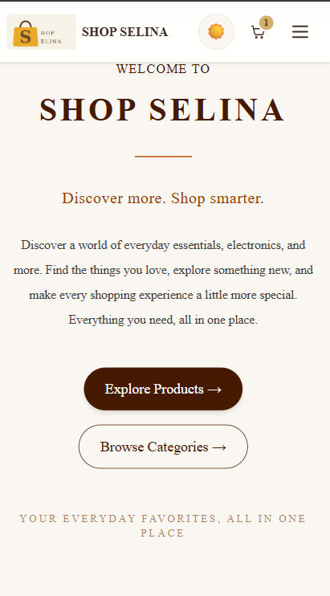 | 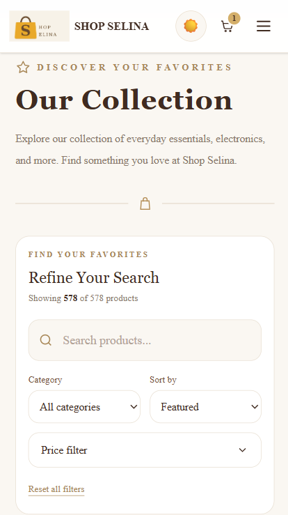 | 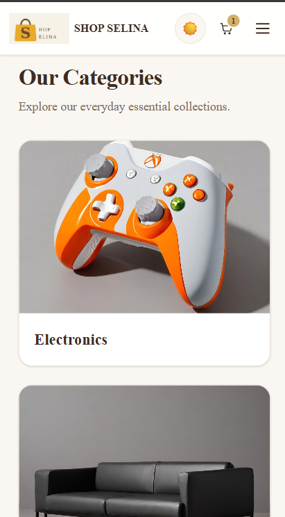 |

#### 2. Mobile Admin Views
> 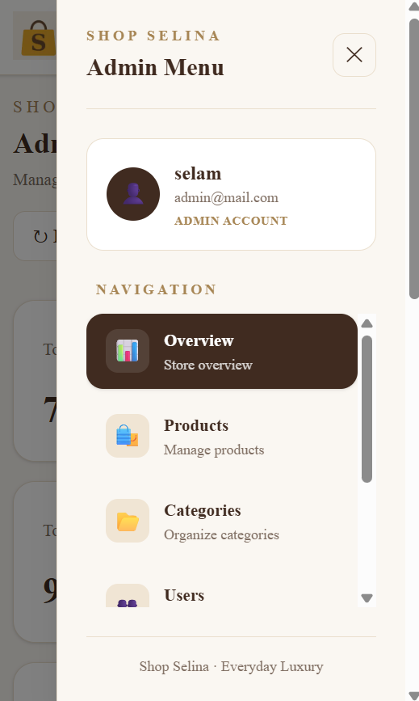
> 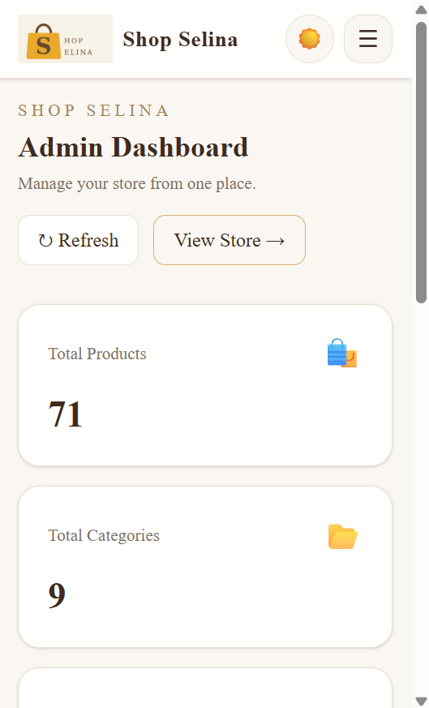

---

### 🖥️ Desktop Views

#### 1. Home Page (`/`)
> 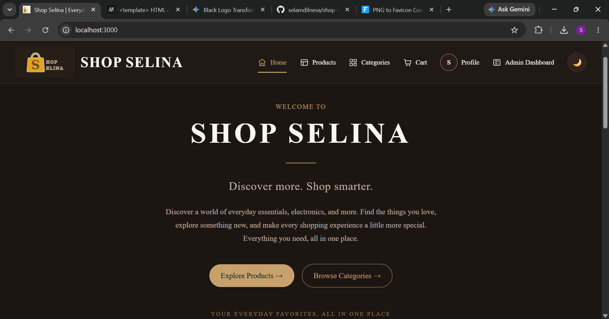
> 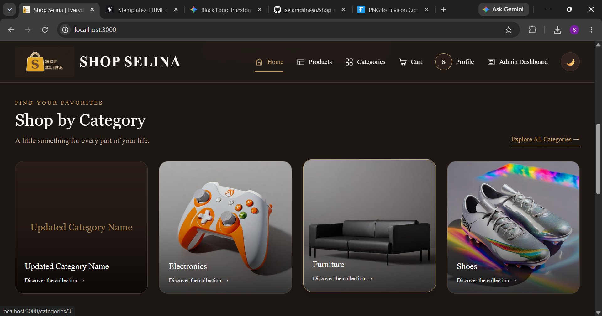
> 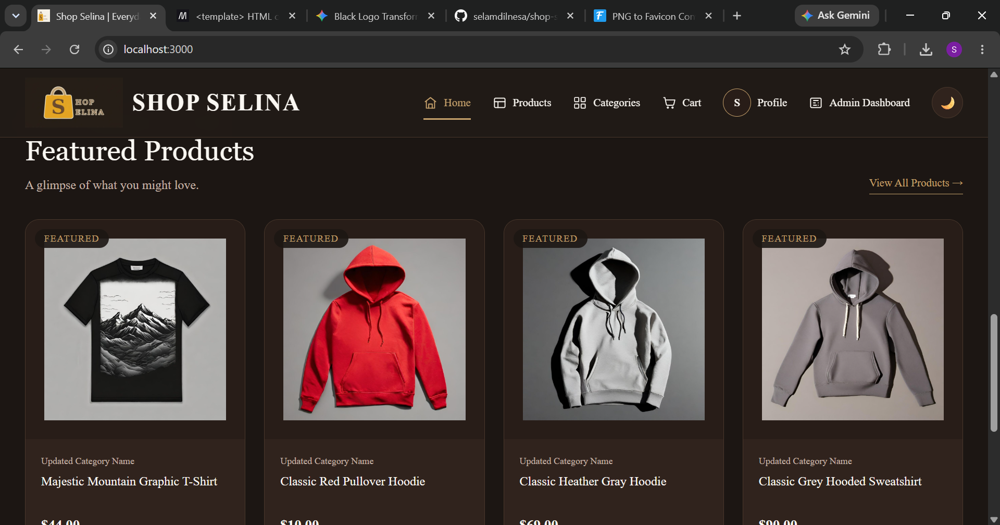

#### 2. Products Catalog (`/products`)
> 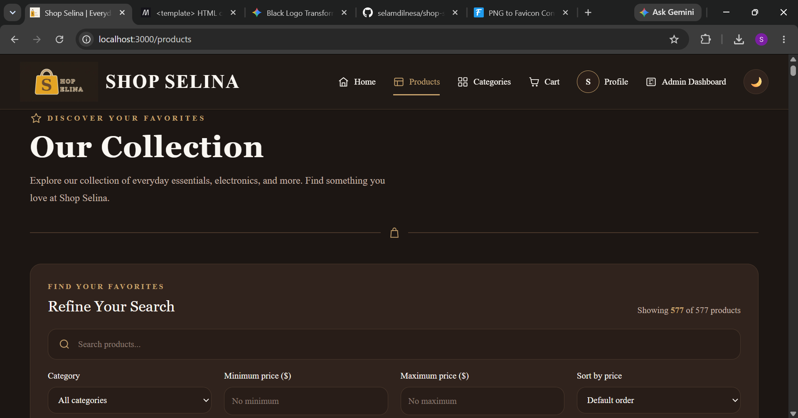
> 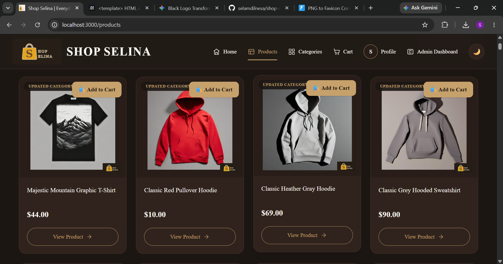

#### 3. Categories (`/categories`)
> 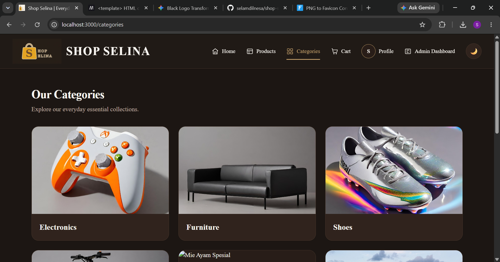

#### 4. Shopping Cart (`/cart`)
> 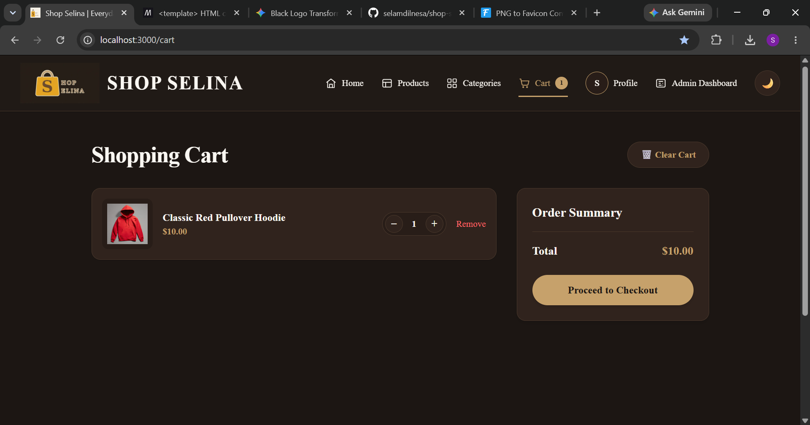

#### 5. Authentication & Profile (`/login`, `/register`, `/profile`)
> 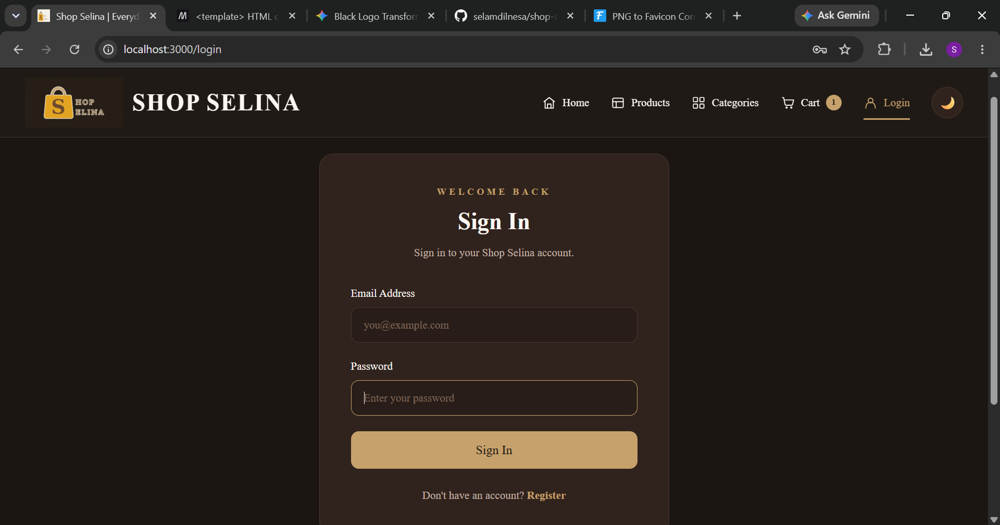
> 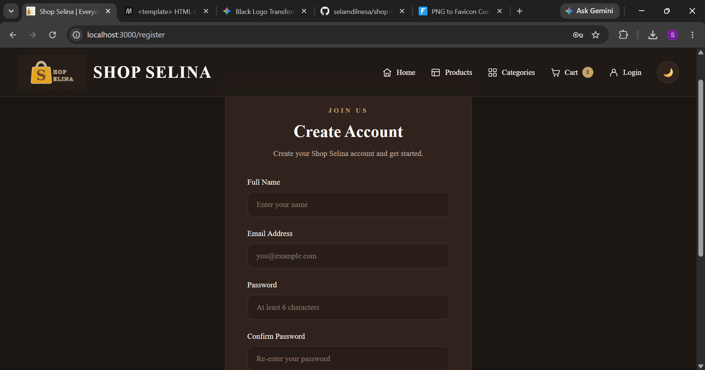
> 

#### 6. Admin Dashboard & Management (`/admin`)
> 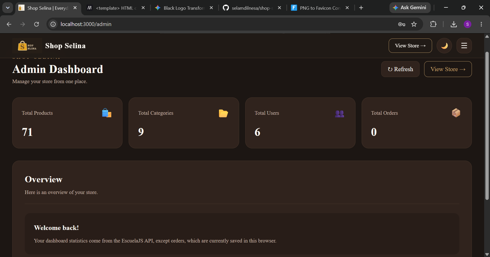
> 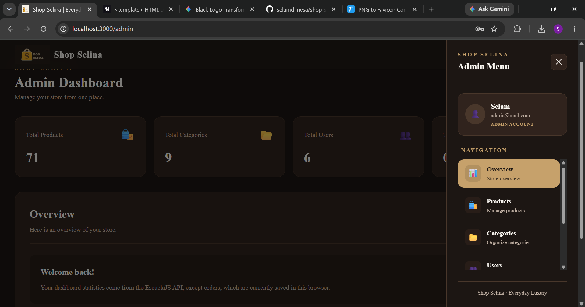

---

## 📁 Project Route Structure

### Customer Storefront
* `/` — Home Page
* `/products` — Product Listing & Search
* `/products/[id]` — Product Details
* `/categories` — Categories List
* `/categories/[id]` — Category Collection View
* `/cart` — Shopping Cart
* `/checkout` — Simulated Checkout
* `/checkout/success` — Order Confirmation
* `/login` & `/register` — Authentication Pages
* `/profile` — User Profile

### Admin Dashboard
* `/admin` — Admin Overview & Analytics
* `/admin/products` — Product Management Table
* `/admin/products/new` — Create Product
* `/admin/products/[id]/edit` — Edit Product
* `/admin/categories` — Category Management
* `/admin/users` — Registered Users List

---

## ⚙️ Getting Started & Installation

To run this project locally on your machine, follow these steps:

1. **Clone the repository:**
   ```bash
   git clone [https://github.com/selamdilnesa/shop-selina.git](https://github.com/selamdilnesa/shop-selina.git)
   cd shop-selina